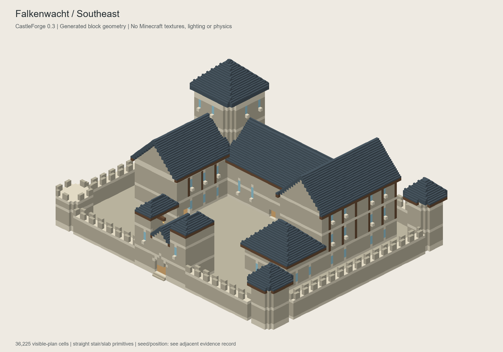
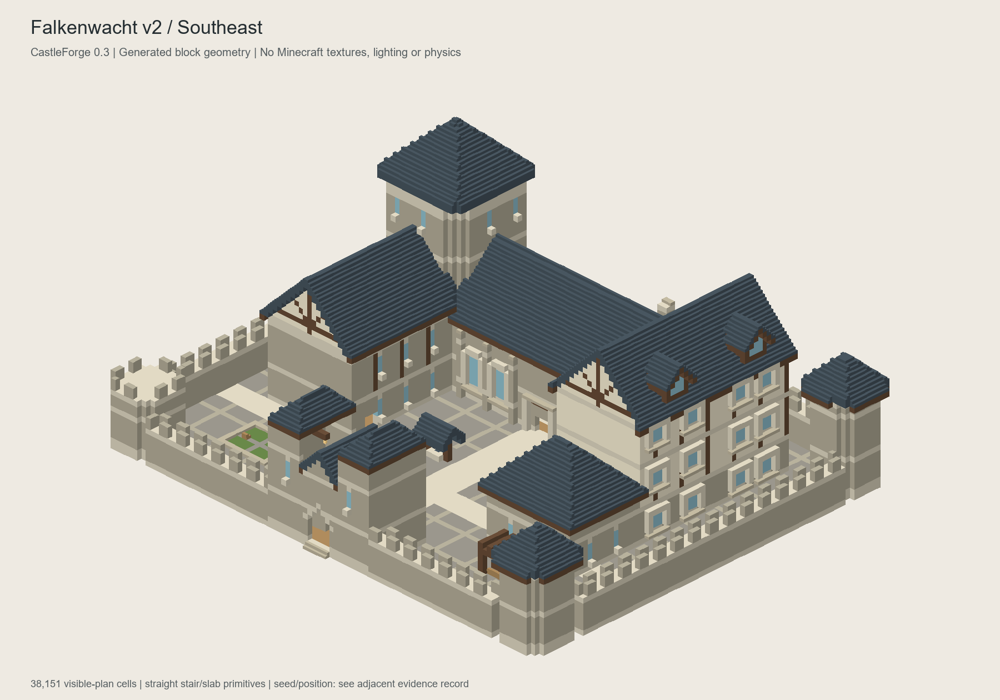
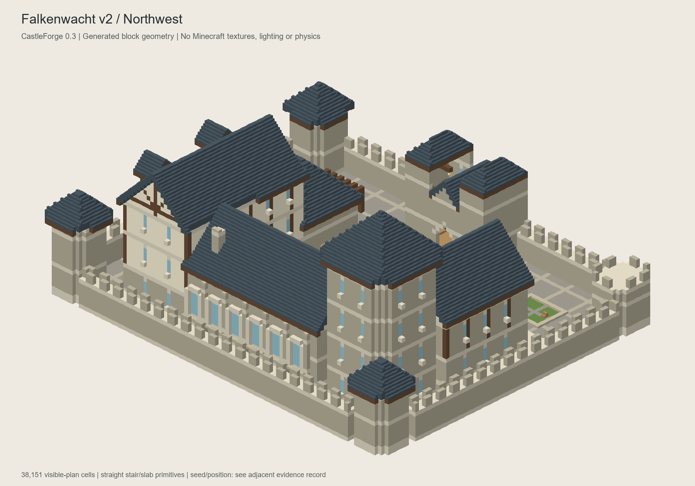
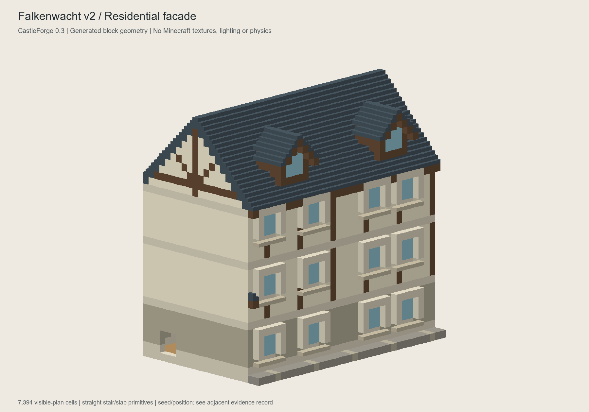
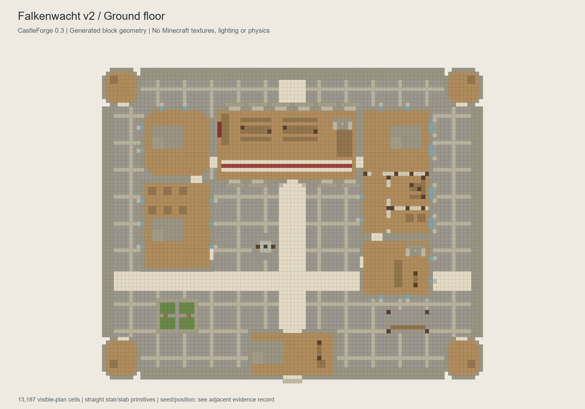
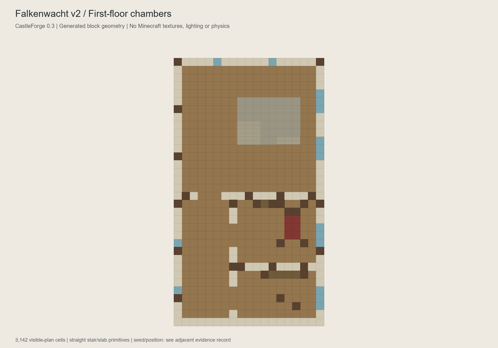
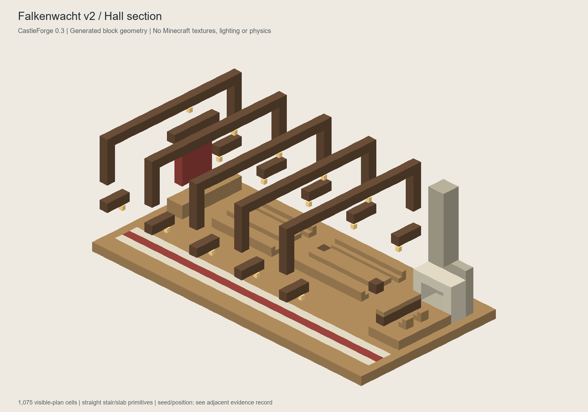
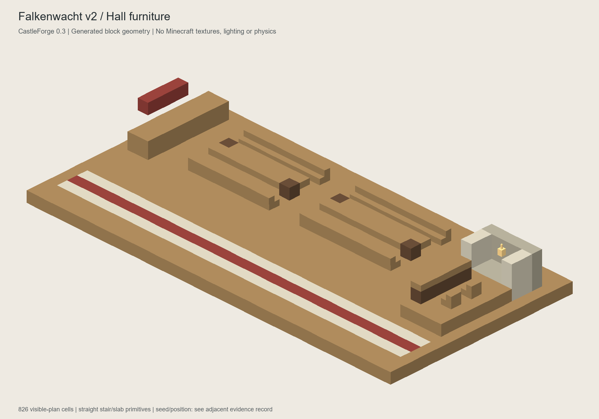
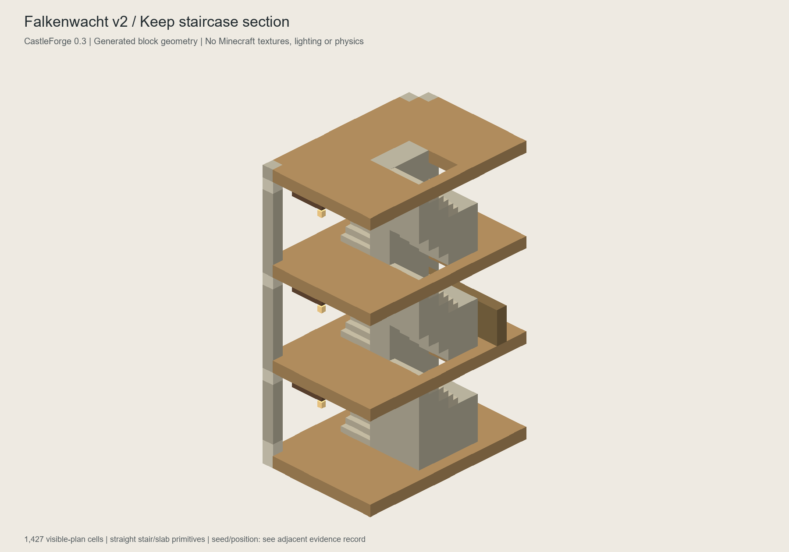
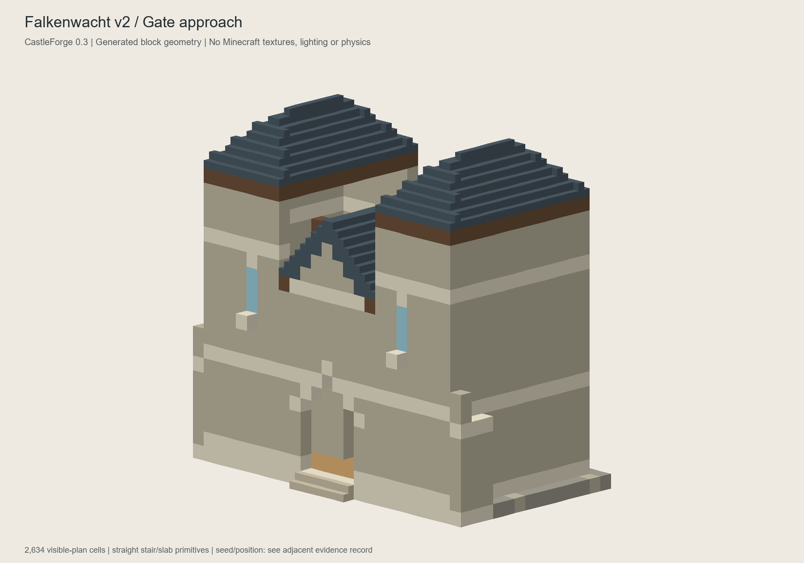

# Falkenwacht v2: detail study, not accepted architecture

Runtime version: **0.3.0-alpha.2**. Branch:
`feat/castleforge-0.3-architecture-core`, continuing PR #7 from `e94e13f`.
PR base remains `feat/reference-castle-0.3`; main is unchanged.

The owner's v1 Minecraft screenshots were reviewed and the visual rejection
is accepted. This iteration fixes selected architectural weaknesses, **not
the complete gap to month-long player builds**. Read
[ADR 0002](ADR_0002_VISUAL_REJECTION_AND_DETAIL_STUDY.md) and the
[product direction](PRODUCT_DIRECTION.md) for what remains mandatory.

## Actual changes

| Area | V1 | V2 study |
|---|---|---|
| Residential rooms | One logical room per entire storey | Separate stair lobby plus two chambers per storey; nine physical partitions and protected portals |
| Hall / east residence windows | Single-block slit glazing | 22 declared wide facade bays with projecting surrounds; interior/exterior clearance verified |
| Roof detail | Uninterrupted roof planes and blank gables | Two owned roof lights, timber/plaster gable framing, a hearth chimney |
| Hall | One oversized-height table; high lamps | Two lower banquet tables, sideboard/tapestry, lower wall brackets, processional floor band, relocated hearth |
| Court | Fully reserved empty pavement | Covered decorative well, herb garden, seating arbor; explicit free approach and paving hierarchy |
| Rejection diagnostics | Unknown/protected ground | Actual BlockState and separate block-entity reason; conservative policy retained |

There are 15 primary modules, 23 declared reachable rooms, 14 three-wide
stair flights and 72 declared wall windows. Wider windows and roof lights
do not imply more distinct layouts. There is still one authored composition.

## Generated geometry views

These are **technical renderings of actual emitted blocks**, not Minecraft
screenshots, concepts, textures or a lighting simulation. Cropped sections
remove walls/ceilings to expose furnishings; apparent floating brackets in a
section attach to the omitted walls in the full build. New top slabs are
rendered as top halves, unlike ordinary bottom slabs. Colors are schematic.

### Exterior comparison, same seed/site and camera

V1 (rejected):



V2 study:





### Close views and floor plans















## Assessment: gate remains open

The residential elevation now has depth, recognizable upper infill and
roof articulation. Separate chambers make the floor plan more purposeful;
table height no longer dwarfs the benches. These are concrete improvements.

The enclosing rectangle and overall massing are mostly unchanged. The keep,
gatehouse, curtains and service elevations are still simple; the court is
too broad to feel densely inhabited. The north stair lobbies are generous.
Only selected elevations use the new bay vocabulary. There is no complete
wall-walk circuit. No claim of production-worthy aesthetics or owner approval.

## Verification status

- Baseline was rerun before changes: all four suites passed, including v1's
  30 accepted sites and 24 deliberate invalid cases.
- Unchanged classic: 50 seeds / 5,727,712 assertions. Terraced: 160 accepted
  sites / 24,757,466 assertions; old digest
  `6fd20d8855fdc190a7e81e9772cef9d4aad3974a3a405ca25f31161b643f7828` retained.
- Identity: 100 seeds x eight cultures / 23,210 assertions.
- V2 reference: 30 accepted sites, 29 deliberate invalid cases, one
  interruption case / 1,634 assertions. Determinism, all four rotations,
  negative/world-edge coordinates, terrain bounds, routes, stairs, supports,
  room/partition separation, glazing, removed partitions/jambs/dormer cap
  and blocked chamber portals are covered. Java 21, 512 MiB heap.
- The exported model records the exact final block digest and one cold
  planning duration in [model.txt](evidence/reference-v2/model.txt). Duration
  is not an FPS measurement or a benchmark.
- All nine final geometry views inspected. **No new Minecraft launch,
  player traversal, runtime lighting, slab/neighbor-update or undo test.**
- V1's supplied screenshots establish that the owner ran the previous build;
  they cannot establish runtime correctness of alpha.2.
- Full Fabric build and runtime artifact: see the CI record below once built.

## Reproduce / narrowly test

```powershell
./scripts/verify-core.ps1 -ExportReference
python scripts/render-reference-set.py build/reference docs/evidence/reference-v2
```

Linux/CI: build with the pinned JDK 25 / Gradle 9.4.0; run ReferenceExport
using the main and test classpaths as shown in REFERENCE_ARCHITECTURE.md.
Evidence uses seed `20261020`, origin `(0,0)`, constant surface `64` and
rotation `3`. Model coordinates in the TSV/views are canonical.

First compare the facade/chamber/hall images above; another full-world
playtest is not required merely because the build is green. If testing the
increment in a separate disposable superflat instance, install only alpha.2
runtime, then `/castleforge preview reference`, wait for `PREVIEW READY`,
inspect and confirm. Compare wide windows, residential doorways and the new
table/slab height with flight disabled. Check night lighting without shaders
and actual lantern attachment, then cancellation/conflict-preserving undo.

No existing Prism instance, downloaded example world or long-term save was
modified. Relief remains <=3 blocks; no automatic world generation. V1
remains available at its prior commit/artifact and in the retained evidence.
