# Falkenwacht v3: connected defensive circuit

Version **0.3.0-alpha.3**, 2026-10-21. Continues
`feat/castleforge-0.3-architecture-core@0a51fc716e1d6fc87be5288212a820fe57526ccc`.
PR #7 remains a draft based on `feat/reference-castle-0.3@d2224b0`, not main.
The checkout was clean before this work. V2 already contained the chambers,
facade bays and courtyard ensembles; those were not reimplemented.

## Decision and actual changes

The v2 block views show a stronger residence but an enclosing rectangle with
disconnected curtain tops. Complete a meaningful exploration route before
adding another layout family. This is a focused increment, not visual acceptance
of the whole castle or completion of issue #4's multi-family generator.

- Immutable, typed `WallWalk` sections extend the existing architecture model.
  Five curtain sections, four tower platforms, an upper gate crossing and a
  court stair declare their deck, guard ownership and protected circulation.
- Three-block-wide walks run on floor Y=6, through all four corner towers.
  Two three-wide, two-rise flights meet the gatehouse's existing floor Y=8.
  The gate's internal stair supplies another access to the circuit.
- A three-wide six-rise court stair has broad upper/lower landings. Tower
  floor Y=6 is a real ceiling over the lower guardroom. Portal chamfers are
  narrowed from two blocks to one, preserving the original ground-room bounds.
- Inner parapets and outer crenels follow the planned paths. The court stair
  shares the west curtain's guard column explicitly in the model; the emitter
  still rejects cross-owner writes. Projecting tower-corner guards have floor
  corbels tied into the surrounding tower floor.
- Guards, floors, route clearance, three-block headroom and final connectivity
  are checked after furnishing. The upper gate gets fitted seating clear of
  its widened crossing; furnishing requirements were not weakened.
- Architecture signature/version become `falkenwacht-v3-wallwalk` / 3. No culture
  geography, 7x scaling, save settings, classic/terraced code or Fabric placement,
  conflict, cancellation and undo policy changed. No worldgen was added.

The new module is an open court stair. Curtain bounds on the south reserve the
raised transition and its headroom; the ordinary curtain masonry stays six
blocks high. Extended inner decks are tied into the curtain masonry rather than
standing on arbitrary tall site foundations. The site relief limit remains 3.

## Geometry and local verification

Baseline alpha.2 passed all four suites before edits. Final local verification:
Windows, Temurin 21.0.5, `javac --release 21`, `java -Xmx512m`.

| Suite | Actual result |
|---|---|
| Classic | PASS: 50 seeds, 5,727,712 assertions |
| Terraced | PASS: 160 sites, 24,757,466 assertions; unchanged golden digest |
| Identity | PASS: 100 seeds x eight cultures, 23,210 assertions |
| Reference v3 | PASS: 30 accepted sites, 36 invalid scenarios, one interruption scenario, 1,905 assertions |

The reference suite includes all four rotations, negative/world-edge coordinates,
shallow terrain, deterministic replays and final furnished geometry. An independent
340-block closed elevated centreline crosses all four towers and the upper gate;
it cannot substitute a ground-level shortcut for a missing connection. Every lane
of the three new flights is sampled as actual straight-stair half-block surfaces
between full-width landings. Removing deck/guard cells, blocking tower/gate routes,
or reversing any new flight is rejected. These tests model the supported primitive
subset, not Minecraft's complete collision or neighboring-block behavior.

Terraced digest retained:
`6fd20d8855fdc190a7e81e9772cef9d4aad3974a3a405ca25f31161b643f7828`.

Reference suite digest (seed 42):
`aa1aa7c28847d98c8cd86ebe3d89c9c236b16b87717c22003fecd09c6b1b7a87`.

Evidence TSV digest (seed 20261020, origin 0,0, flat ground 64, rotation 3):
`95a8968c6a41b3bc2dabb673af8ce01c8ea3bdaddacbc31a4f3675e8b2983e4d`.

16 modules, 23 declared reachable rooms, 17 stair flights, 72 windows;
94,024 planned cells, including 40,792 non-air cells and 53,232 explicit air
cells; 18,299 reserved clearance cells. Tower upper platforms are circulation,
not four new furnished rooms. Extent remains 101 x 95 x 44 blocks. One cold
export planning invocation was 351 ms locally; this is not an FPS measurement,
server-tick benchmark or measured peak-memory result.

## Actual emitted block views

All thirteen views were inspected. These are **technical renderings of the
actual exported block plan**, without Minecraft assets, textures, lighting or
physics. Cuts omit roofs/walls intentionally; the low circuit cut omits the
raised gate crossing, which is shown separately. Compare v2's retained evidence.

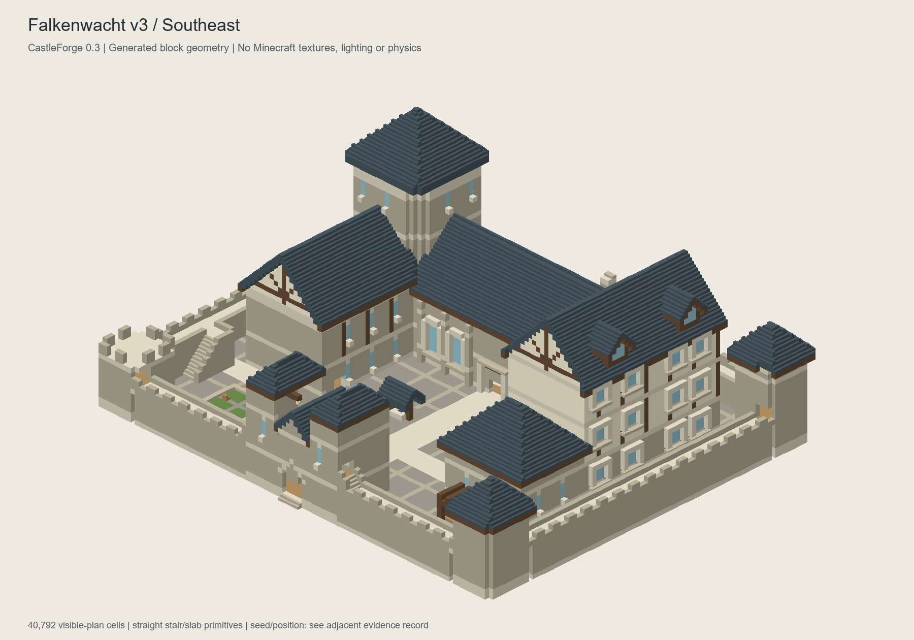
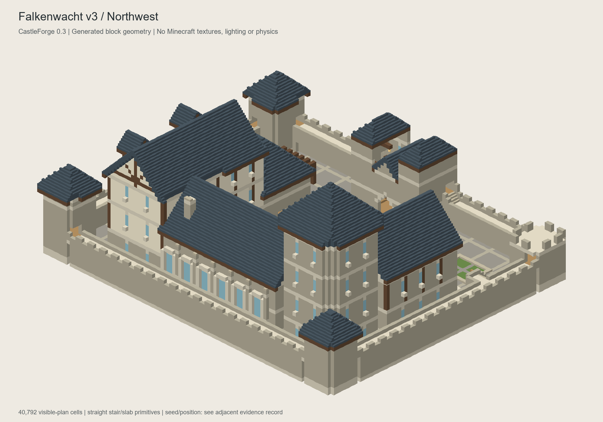
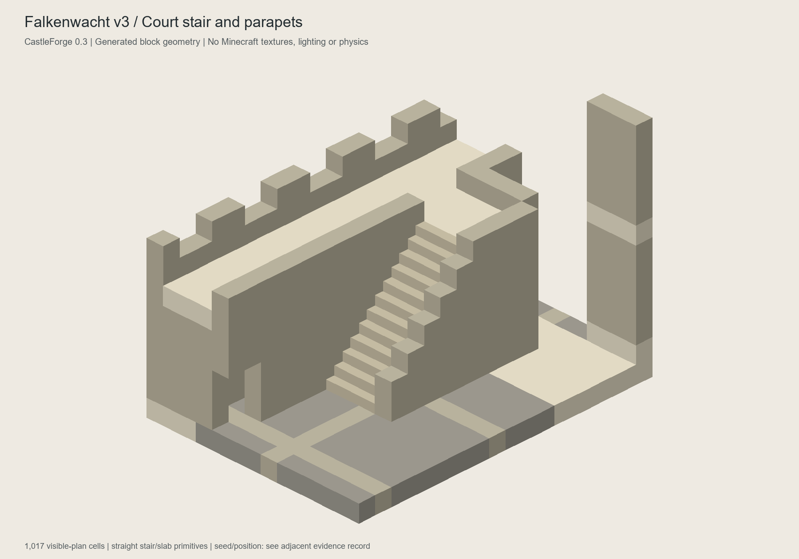
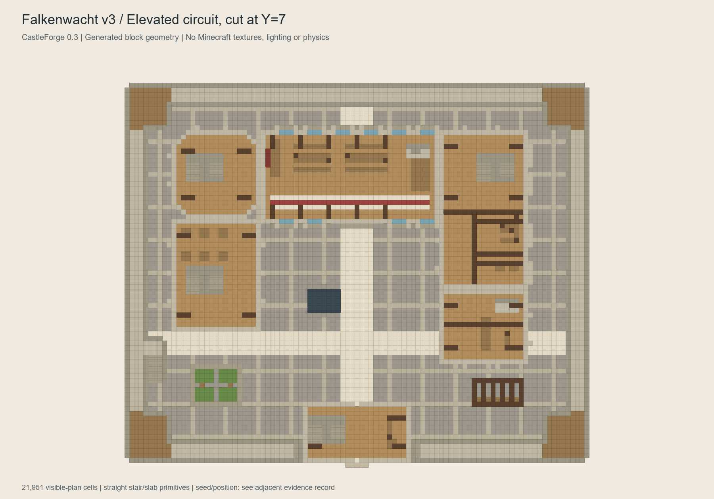
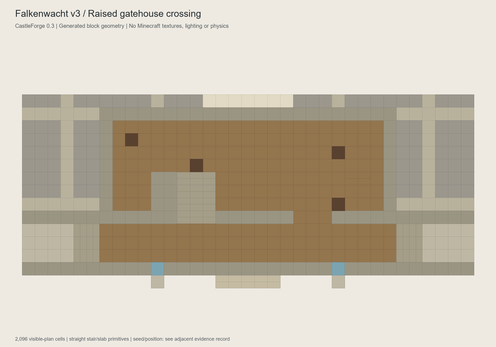
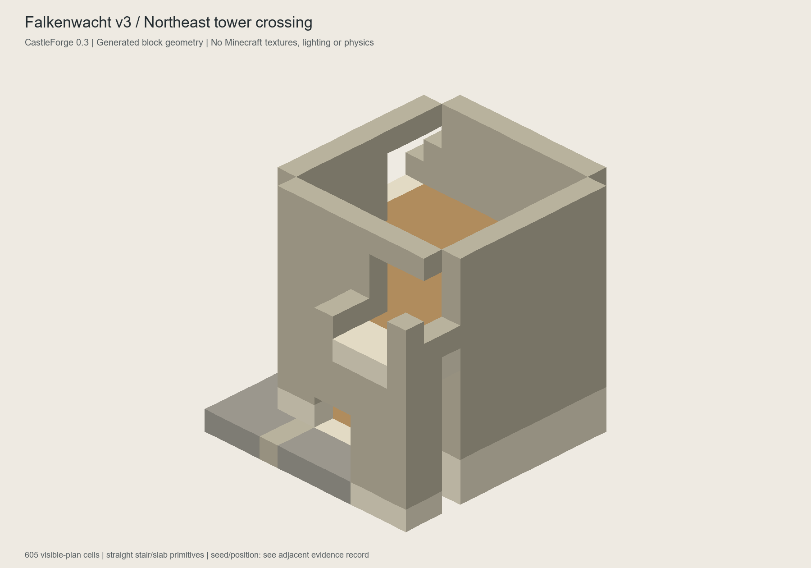
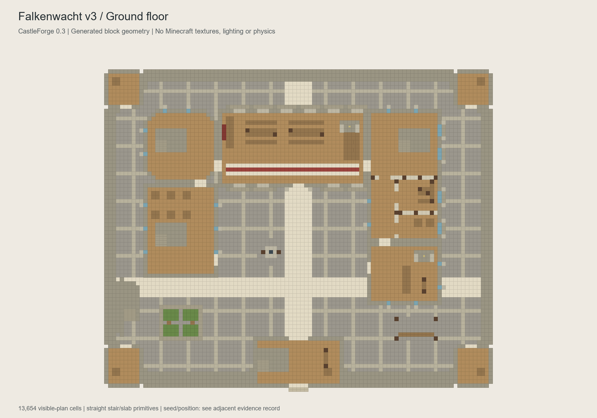
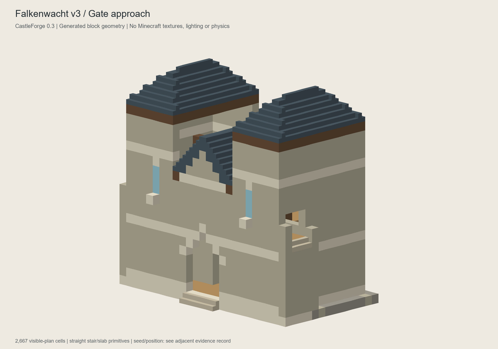
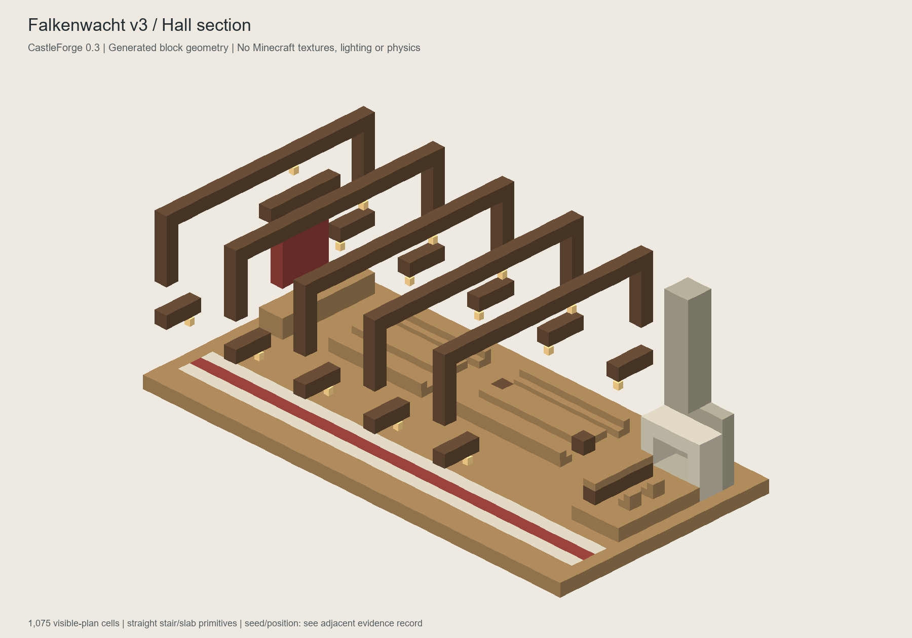
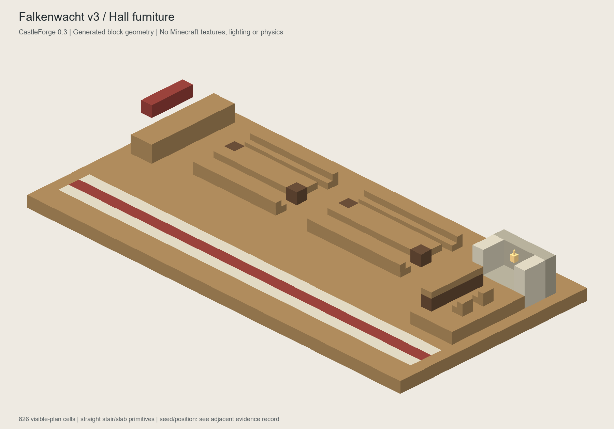
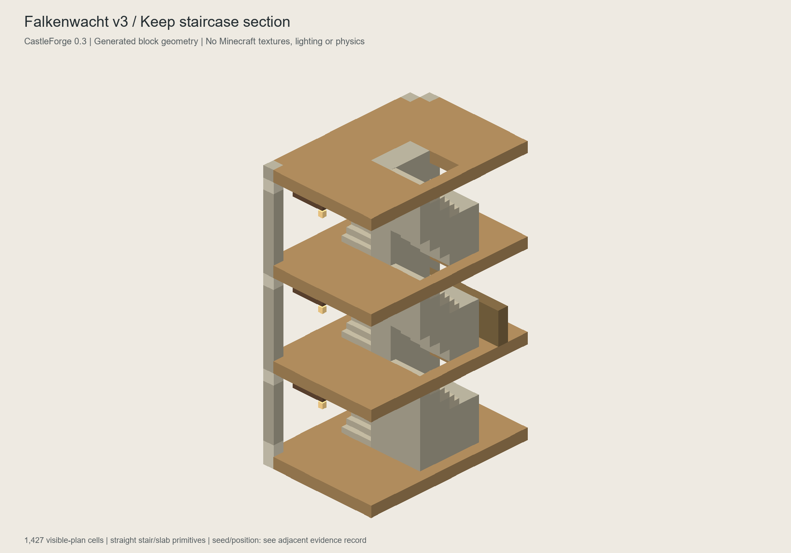
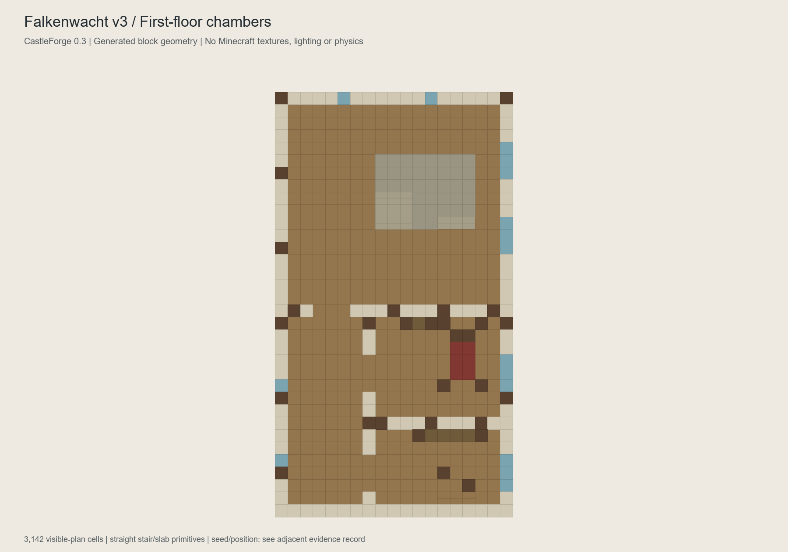
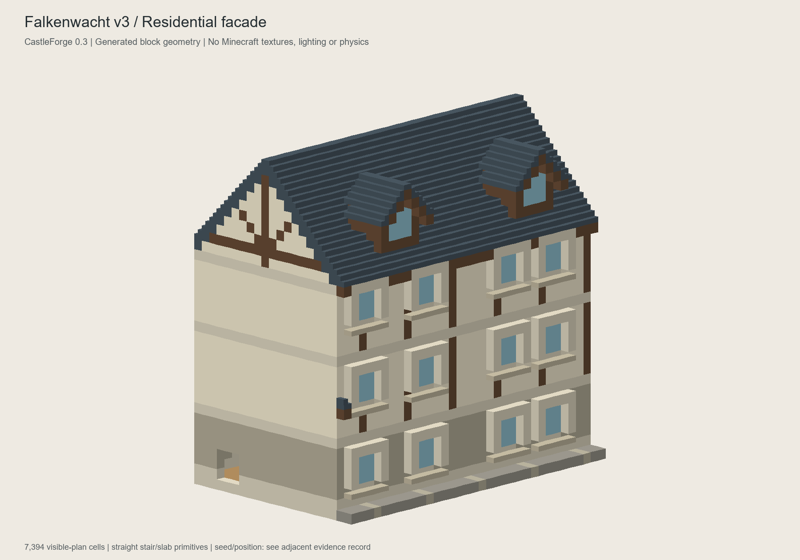

First visual iteration had two-course continuous guards: these concealed views
and made the walls too closed. The final version uses low inner parapets and
outer crenels. The stair/circuit now have readable entrances. The main massing,
large gridded court paving, simple gate/keep and undecorated upper tower platforms
remain weak. This is progress in spatial exploration, not a claim that the castle
has reached the requested hand-built visual standard.

## Build and runtime gates

The full pinned Java 25 / Gradle 9.4.0 / Fabric build is recorded after CI finishes.
Do not install a JAR unless the successful run and its exact hash are listed.

No Minecraft client/server was launched in this round. Actual player movement,
stairs after neighbor updates, lighting, reload, cancellation/undo and performance
remain unconfirmed. No Prism instance, long-term world or global setting changed.

## Focused disposable-world test

Use an isolated Prism instance named `CastleForge-alpha3-abnahme` with a new
Creative superflat world, seed `20261020`, cheats and Vanilla textures. Verify
the actually active Minecraft 26.1.2, Loader >=0.19.5, Fabric API
0.155.3+26.1.2 and Java 25. Install the runtime alpha.3 JAR only, not sources.
No existing instance has been created or altered by this development round.

1. Keep the entire 109 x 109 survey loaded. Run `/castleforge preview reference`,
   wait for `PREVIEW READY`, then `/castleforge inspect`, `/castleforge build confirm`.
2. Enter the court and disable flight. Use the new stair beside the herb garden.
   Walk a full circuit in both directions, including every corner tower and
   both steps into/out of the upper gate. Also descend via the gate's old stair.
   The court stair is west in canonical geometry; rotation changes compass sides.
3. Check all three lanes and overhead clearance, actual automatic stair shapes,
   the lower guardrooms' new ceilings, upper-gate seating and window clearance.
4. Compare dusk/night lighting without shaders. The new platforms have no added
   lamps; core reachability does not prove adequate nighttime illumination.
5. In disposable builds, test cancel mid-placement and session undo; then edit
   blocks/add a container and verify those conflicts survive undo. Record logs.

For an agent-run local playtest, separate authorization is required to create
and launch exactly this isolated instance/world, install only the pinned test
dependencies and alpha.3 runtime, and exercise the commands above. This follows
the user's handoff boundary; no EULA or unrelated installation is authorized.

Reproduce core/evidence:

```powershell
./scripts/verify-core.ps1 -ExportReference
python scripts/render-reference-set.py build/reference docs/evidence/reference-v3
```
