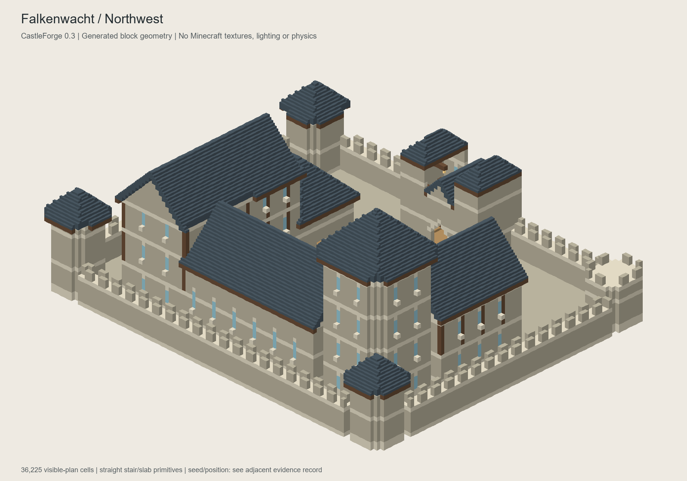
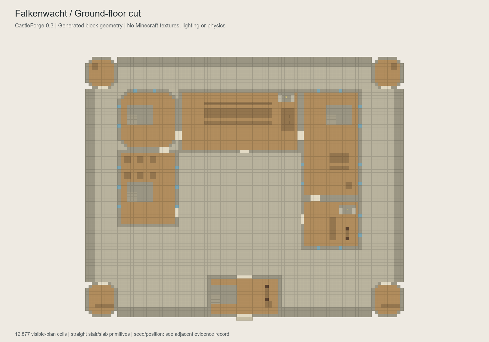
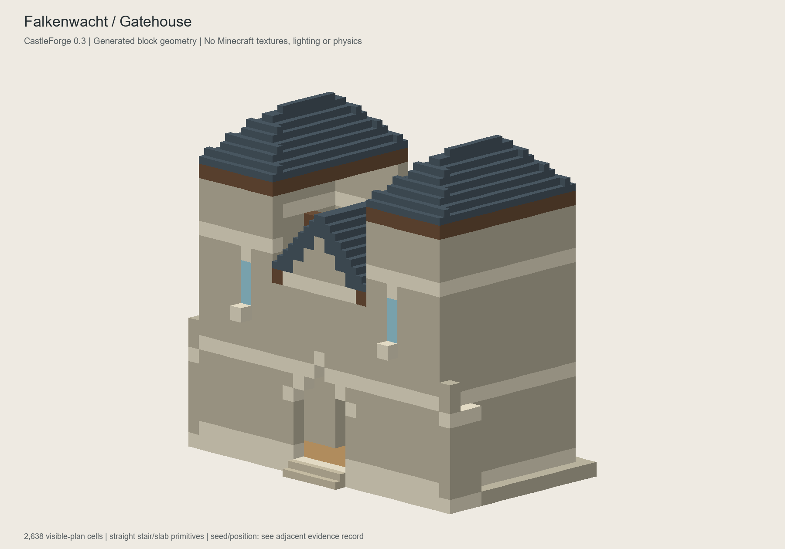
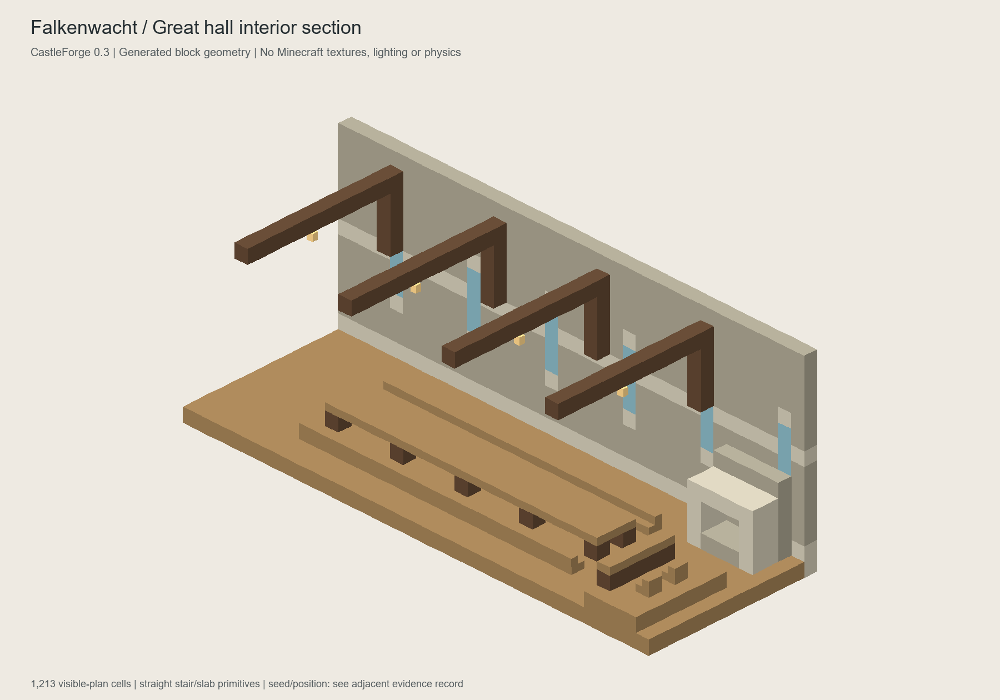
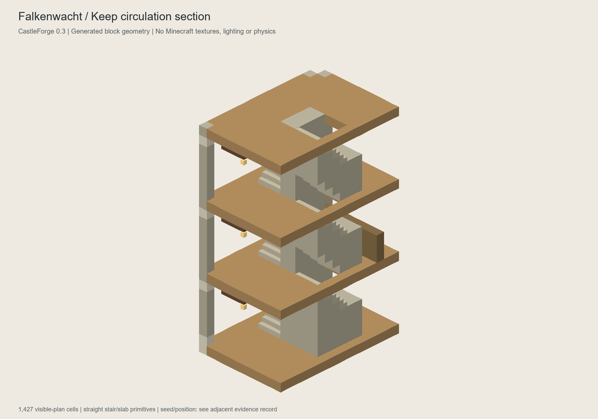

# Reference validation / 2026-10-20

Branch: `feat/castleforge-0.3-architecture-core`, based on
`feat/reference-castle-0.3@d2224b09c2b6ca34f13fb6ce7fb64ca4611a0378`.
Version: `0.3.0-alpha.1`. No merge, release, installed-instance changes or
existing-world changes.

## Actually executed locally

Windows, Temurin JDK 21.0.5, dependency-free `javac --release 21` and
`java -Xmx512m`. Baseline's three suites passed before implementation and were
rerun with the complete new source through `scripts/verify-core.ps1 -ExportReference`.

| Suite | Result |
|---|---|
| Classic | PASS: 50 seeds; 5,727,712 invariant assertions |
| Terraced | PASS: 160 sites, no unexpected rejection; 100 bridge / 96 stair sites; 4.23 s locally |
| Identity/diagnostics | PASS: 100 seeds x eight cultures; 23,210 assertions |
| Reference | PASS: 30 accepted sites, 24 deliberate invalid scenarios, one interrupted-planner test; 1,319 assertions; 6.57 s locally |

Per-voxel assertions are not millions of distinct scenarios. Reference covers
16 seeds/all four orientations, all eight culture metadata values, negative and
world-edge positions, two shallow terrains in every orientation, deterministic
replays, model/room/module validity, final route clearance, stairs, supports,
window exteriors, roof presence/anchoring and attachment ordering. Mutations
must fail. An independent half-block surface walk tests all five approach lanes
from natural ground to the gate; the runtime planner also rejects an unsafe approach.

Classic/terraced generation, culture map, save settings and legacy palette source
files were not changed. Terraced digest remains:

```text
6fd20d8855fdc190a7e81e9772cef9d4aad3974a3a405ca25f31161b643f7828
```

New suite's block digest, seed 42 / origin 0,0 / surface 64:

```text
9bb35ccdbf83bf34e1c5d051b2528361ce364995816003de8a82337047597682
```

## Actual generated-block visual evidence

Exporter: `ReferenceExport`; renderer: `scripts/render-reference.py`, Python
3.10.11 / Pillow 12.0.0. **These are technical geometry views, not Minecraft
screenshots, generated concept pictures, Minecraft textures or game-physics tests.**

Fixed view input: seed `20261020`, world origin `0,0`, flat surface `64`, selected
rotation `3` (270 degrees). The images show canonical local coordinates so that
the same modules and sections remain comparable regardless of world rotation.

- 15 modules, 17 declared reachable rooms, 14 three-block-wide stair flights,
  72 windows and 16,817 reserved route cells.
- 89,196 planned cells: 36,225 non-air cells and 52,971 explicit clearance cells.
- Plan extent including overhangs/approach: 101 x 95 x 44 blocks
  (local x -50..50, z -41..53, y 0..43).
- One cold export planning call: 302 ms locally; this is not a benchmark, server
  tick timing, peak-memory measurement or FPS claim. Heap limit was 512 MiB.
- 85 hanging lanterns; no glowstone, ladders, block entities, doors, beds or fire.

TSV SHA-256 (the differently formatted suite digest above is intentionally distinct):

```text
2e6567c1476f1bc35938f1b44a9edec993c6d83619b78eb5317b6bc0b305c6c1
```

[Exact generated model](evidence/reference-v1/model.txt)








The sections intentionally cut walls/floors and beams. Exposed cut faces are not
claims that those elements float in the full plan. The renderer handles straight
stairs, bottom slabs and simplified lantern geometry; neighbor-computed stair
corners and light are not simulated.

## Iteration performed

1. Collision checks caught overlapping roof overhangs at a wing junction. Added
   an explicit dominant-mass roof abutment/cropping rule; did not disable ownership.
2. Independent approach tests caught a full-block jump at the raised gate and
   another at the outside edge on rotated shallow terrain. Corrected tread
   heights and per-lane taper; invalid rough approaches are rejected.
3. Viewed both complete generated block perspectives. Added windows to exposed
   keep and courtyard-facing wings; checked them against actual exterior cells.
4. Inspected hall/stair cuts and floor plan. Fixed skipped bedroom, kitchen and
   guardroom ensembles, required functional furniture per room, replaced floating
   lamp supports, and filled the staircase's central gap with a supporting spine.
5. Re-exported the fixed seed and regenerated/reviewed the final views above.

## Build and runtime status

The local offline cache lacks pinned Gradle 9.4.0 and Fabric/Mojang dependencies.
Microsoft JDK 25.0.1 is available, but a full local offline Fabric build was not
claimed. The pinned complete build succeeded in
[GitHub Actions run 39462643241](https://github.com/badmon61/castleforge/actions/runs/39462643241)
for implementation commit `32c267506f5b4dc4f4f6ca6f19a86d1abd166a6e`:

- Java 25 / Gradle 9.4.0; `gradle --no-daemon build --stacktrace`:
  **BUILD SUCCESSFUL in 35s**. All four suites passed; reference took 10.54 s on CI.
- Archive metadata, included old/new runtime classes and absence of bundled
  Minecraft classes/test suites passed `verify-artifact.py`.
- Actual-block export on Linux/Java 25 matched the local Windows/Java 21 TSV
  digest exactly. Its cold planning invocation took 614 ms on that runner.
- [JAR artifact 12283402667](https://github.com/badmon61/castleforge/actions/runs/39462643241/artifacts/12283402667)
  contains the runtime and sources JAR. Install only the runtime JAR below.
- `verification-reports` artifact `12282773379` contains the build log,
  actual block TSV, model and JAR digest. The ZIP artifact digest is distinct
  from the runtime JAR's SHA-256.

Runtime artifact: `castleforge-fabric-0.3.0-alpha.1.jar`:

```text
a253ce625e9b6baeaa3a57218b4c4e2c05c7313abf1ffc24dcfa79f5f5eac7d1
```

[Draft PR #7](https://github.com/badmon61/castleforge/pull/7) targets
`feat/reference-castle-0.3`, not `main`. This evidence update changes documentation
only after the tested implementation commit.

**Not performed:** Minecraft client launch, actual player traversal/collision,
GameTests, dedicated-server start, runtime neighbor updates, block-entity conflict
undo, runtime cancellation/reconnect, shader/Vanilla-texture acceptance, real
snapshot/preflight/placement tick timing or peak-memory profiling. No EULA was
accepted for a new server. These are separate gates in the manual test guide.

## Still weak / intentionally deferred

The court remains sparse and the residential storeys need finer subdivisions.
Curtain tops do not yet have a complete accessible wall-walk circuit. Roof
verification is conservative voxel connection/anchoring plus module ownership,
not structural engineering or proof that every visual join is attractive.
Furniture is decorative, and there is one fixed layout with four rotations.
Survey relief is capped at three blocks; a rough approach may still be rejected.
Final `build confirm` conflict checks remain synchronous. The design stays a
draft until real-game checks and the user's visual decision.
